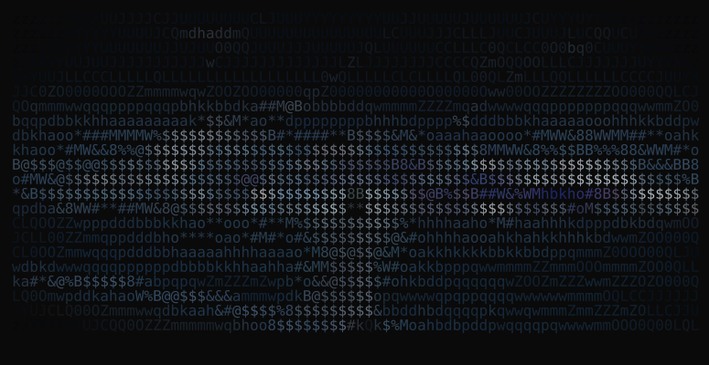
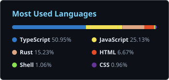

<div align="center">
  
  <br/><br/>
  <h1>Yash Kashyap</h1>
  <p><b>3rd-year CS builder in Delhi &middot; Rust, Go, TypeScript, Playwright &amp; MCP</b></p>
  <p>
    <a href="https://yashh.is-a.dev"></a>
    <a href="https://yashh2313.hashnode.dev"></a>
    <a href="https://www.linkedin.com/in/yashh1323/"></a>
    <a href="https://x.com/yashh2313"></a>
    <a href="https://dev.to/yashh1323"></a>
    <a href="https://www.producthunt.com/@yashh2313"></a>
  </p>

  <a href="https://github.com/pulls?q=is%3Apr+author%3Ayashh1323"></a>
  <a href="https://neomjs.com/badges/yashh1323-183808659/"></a>
  <a href="https://discord.gg/qMu5Xn8Kaq"></a>
  <a href="https://github.com/flisk-sh/flisk/issues/3819"></a>
</div>

---

### What I Build

I am a 3rd-year Computer Science student in Delhi writing open-source developer tools in **Rust**, **Go**, and **TypeScript**. Most of my projects exist because an existing workflow annoyed me enough to replace it: post-hoc AI essay detectors flagging honest students, browser MCPs burning 35k tokens to click through one Playwright form, or prompt-only UI skills breaking dashboard tables.

- **Deterministic Verification in Rust:** Building zero-unsafe `Axum` / `Rayon` compute pipelines (Winnowing fingerprints, MinHash LSH, Burrows' Delta, and keystroke dynamics) backed by PostgreSQL + Supabase RLS.
- **Zero-Token Playwright & MCP Tooling:** Separating one-shot `~1.2k`-token accessibility tree discovery from `$0` local Playwright replay and native `@playwright/test` `.spec.ts` codegen.
- **Zero-Dep Browser & Visual Checks:** Writing static CSS/JSX linters and local Chrome/Edge CDP verifiers using Node 22 built-ins instead of heavy dependency chains.
- **Upstream Open-Source Fixes:** Tracking down event-loop scope bugs, `TreeStore` hydration leaks, lockfile write races, and slow Vitest suites in active production repos.

---

### Featured Projects

<table>
  <tr>
    <td width="50%" valign="top">
      <h3><a href="https://github.com/yashh1323/Clio">Clio: Proof-of-Write Authorship Platform</a></h3>
      <p>Records how an essay was composed in TipTap + IndexedDB so teachers get scrubbable Session Replay instead of black-box AI detector guesses or webcam spyware.</p>
      <ul>
        <li><b>Pure-Rust Compute Engine</b> (<code>Axum</code> / <code>Rayon</code>, <code>#![forbid(unsafe_code)]</code>) running Winnowing containment, MinHash LSH, Burrows' Delta, and Log-Normal keystroke checks.</li>
        <li><b>Supabase + Next.js 16 Studio</b> with HMAC auth, RLS tables, and automatic TypeScript fallback.</li>
        <li><b>Verified:</b> <a href="https://clio-three.vercel.app">clio-three.vercel.app</a> (69/69 Cargo tests, 31/31 QA suites).</li>
      </ul>
      <p>
        
        
        
      </p>
    </td>
    <td width="50%" valign="top">
      <h3><a href="https://github.com/yashh1323/auto-qa">Auto-QA: Zero-Token Playwright QA Engine</a></h3>
      <p>Dual-mode Playwright E2E runner and local stdio JSON-RPC 2.0 MCP server for Claude Code, Cursor, and Antigravity.</p>
      <ul>
        <li><b>Low Token Budget:</b> Crawls live DOMs once into a <b>~1.2k-token</b> W3C accessibility snapshot and replays plans locally for <b>$0</b> (~10.3s for 14 steps).</li>
        <li><b>Modal Isolation:</b> Uses <code>getBoundingClientRect()</code> and active dialog scoping so <code>position: fixed</code> checkout drawers do not drop.</li>
        <li><b>CI Ready:</b> Compiles passing JSON plans directly into standalone <code>@playwright/test</code> <code>.spec.ts</code> files (6/6 security checks).</li>
      </ul>
      <p>
        
        
        
      </p>
    </td>
  </tr>
  <tr>
    <td width="50%" valign="top">
      <h3><a href="https://github.com/yashh1323/atelier-ui">atelier-ui: Modular Frontend UI Skill</a></h3>
      <p>Routes between brand landing sites, SaaS app refinement, and 3D WebGL work using scoped modules instead of dumping contradictory rules into one prompt.</p>
      <ul>
        <li><b>Zero-Dep Verification:</b> Static CSS/JSX linter plus Node 22 native WebSocket Chrome/Edge CDP checks for mobile overflow, <code>oklch</code> contrast, and broken images.</li>
        <li><b>Verified Builds:</b> <a href="https://yashh1323.github.io/atelier-ui-showcase/">Live 3-mode showcase</a> (11/11 CI smoke tests).</li>
      </ul>
      <p>
        
        
      </p>
    </td>
    <td width="50%" valign="top">
      <h3><a href="https://github.com/yashh1323/kaze">Kaze: Go Terminal Media Client</a></h3>
      <p>Single-binary terminal anime client and MPV IPC controller written in Go with Bubble Tea TUI and SSRF protections.</p>
      <ul>
        <li><b>Hardened IPC &amp; Network:</b> Blocks loopback/RFC1918/metadata SSRF, caps responses via <code>io.LimitReader</code>, and sanitizes JSON-RPC MPV control.</li>
        <li><b>Playback &amp; Releases:</b> Multi-source failover, GPU shaders, SmartSkip, AniList OAuth sync, and SHA256-verified cross-platform builds.</li>
      </ul>
      <p>
        
        
      </p>
    </td>
  </tr>
</table>

> **Also built:** [`omnirea`](https://github.com/yashh1323/omnirea) (two-tier reverse engineering CLI and MCP toolkit separating fast surface recon from deep binary/WebAssembly inspection).

---

### Upstream Open Source Contributions

* **[neomjs/neo #21009](https://github.com/neomjs/neo/pull/21009)** (`Merged`): Eliminated hidden `TreeStore` hydration during index lookups and retained raw tree-row batch values across structural reprojections.
* **[neomjs/neo #20809](https://github.com/neomjs/neo/pull/20809)** (`Merged`): Fixed core `Observable` event-loop callbacks firing on destroyed scopes; resolved mid-dispatch scope suppression across 217 unit tests.
* **[vercel-labs/skills #2750](https://github.com/vercel-labs/skills/pull/2750)** (`Merged`): Serialized local lockfile updates and switched lockfile writes to atomic operations.
* **[flisk-sh/flisk #3824](https://github.com/flisk-sh/flisk/pull/3824)** (`Merged`): Parallelized CLI registry test suites with concurrent `it.each` Vitest worker pools (awarded Founding Contributor #11).
* **[neomjs/neo #20787](https://github.com/neomjs/neo/pull/20787)** (`Merged`): Decoupled Engine documentation post-repository split; audited 343 cross-file markdown references with zero broken links.

<div align="center">
  <a href="https://neomjs.com/badges/yashh1323-183808659/"></a>
</div>

---

### Recent Engineering Notes

* [Cutting Playwright MCP Runs from 35k Tokens to $0 Local Replay](https://yashh2313.hashnode.dev/cutting-playwright-mcp-runs-from-35k-tokens-to-0-local-replay)
* [Why AI Essay Detectors Fail, So I Built a Rust Proof-of-Write Engine](https://yashh2313.hashnode.dev/why-ai-essay-detectors-fail-so-i-built-a-rust-proof-of-write-engine)
* [Frontend Skills Kept Breaking My Dashboards, So I Added Chrome CDP](https://yashh2313.hashnode.dev/frontend-skills-kept-breaking-my-dashboards-so-i-added-chrome-cdp)

---

### Technical Stack & Toolchain

```text
Languages     ::  Rust  •  TypeScript  •  Go  •  JavaScript  •  Python  •  SQL  •  C/C++
Runtimes      ::  Node.js (>=22)  •  Bun  •  Tokio  •  Axum  •  Rayon  •  V8 / Chromium
Tooling & QA  ::  Playwright  •  Vitest  •  Cargo  •  Git  •  Docker  •  GitHub Actions  •  MCP
Databases     ::  PostgreSQL (Supabase RLS)  •  SQLite  •  Redis
```

<div align="center">


</div>

---

### Primary Languages

<div align="center">
  
</div>

---

<div align="center">

Portfolio: <a href="https://yashh.is-a.dev"><b>yashh.is-a.dev</b></a> (<a href="https://23.is-a.dev"><code>23.is-a.dev</code></a>) &middot; Open to Systems, Full-Stack, and AI Tooling internships or remote roles.

</div>
