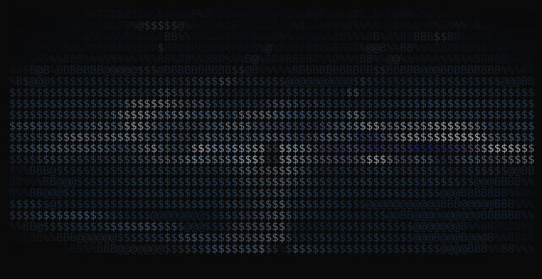

<div align="center">
  
  <br/><br/>
  <h1>Yash Kashyap</h1>
  <p><b>Systems Architecture &bull; High-Performance Runtimes (Rust, Go, TS) &bull; Autonomous Agent Tooling</b></p>
  <p><code>@yashh1323</code> &bull; Open Source Core Contributor</p>

  <br/>

  <a href="https://github.com/pulls?q=is%3Apr+author%3Ayashh1323"></a>
  <a href="https://discord.gg/qMu5Xn8Kaq"></a>
  <a href="https://github.com/flisk-sh/flisk/issues/3819"></a>

</div>

---

### ⚡ Architectural Focus

I engineer high-throughput developer infrastructure, deterministic verification engines, and resilient distributed tooling. My work bridges low-level systems programming in **Rust** and **Go** with modern **TypeScript** runtimes, Model Context Protocol (MCP) servers, and autonomous agent orchestration.

* **Systems & Runtimes**: Multithreaded execution loops, asynchronous I/O (`Axum`, `Rayon`, `Tokio`), memory-safe data structures, and custom IPC channels.
* **Deterministic Verification**: Replacing heuristic AI guesswork with mathematical Proof-of-Write (MinHash LSH, keystroke dynamics, session replay).
* **Agent Tooling**: Zero-token ($0) local Playwright test compilers, accessibility AST extractors, and stdio JSON-RPC 2.0 MCP servers.
* **Core OSS Contributions**: Surgical bug fixes and performance refactors in production-scale web engines, container orchestrators, and data pipelines.

---

### 🏛️ Featured Projects

<table>
  <tr>
    <td width="50%" valign="top">
      <h3><a href="https://github.com/yashh1323/Clio">Clio — Proof-of-Write Authorship Platform</a></h3>
      <p>Deterministic academic authorship verification platform that validates how text was composed in real time rather than guessing from token perplexity after the fact.</p>
      <ul>
        <li><b>Pure-Rust Compute Engine</b> (<code>Axum</code> / <code>Rayon</code>) calculating pairwise MinHash LSH similarity, Burrows' Delta stylometry, and keystroke inter-key intervals (IKI).</li>
        <li><b>TipTap ProseMirror Studio</b> with client-side <code>IndexedDB</code> snapshots, cloud sync, and scrubbable Session Replay.</li>
        <li><b>Live Cloud Deployment</b>: <a href="https://clio-three.vercel.app">clio-three.vercel.app</a> (69/69 Cargo tests, 31/31 QA suites).</li>
      </ul>
      <p>
        
        
        
      </p>
    </td>
    <td width="50%" valign="top">
      <h3><a href="https://github.com/yashh1323/auto-qa">Auto-QA — Zero-Token Playwright QA Engine</a></h3>
      <p>Autonomous end-to-end testing engine and stdio MCP server for Claude Code, Google Antigravity & Cursor. Replaces 40,000-token browser loops with zero LLM execution cost.</p>
      <ul>
        <li>Crawls live DOMs into <b>~1.2k-token W3C accessibility snapshots</b> with active modal and sticky-header isolation.</li>
        <li>Executes plain-English intent plans locally with self-healing selector resolution.</li>
        <li>Compiles executed runs directly into native <code>@playwright/test</code> <code>.spec.ts</code> test suites.</li>
      </ul>
      <p>
        
        
        
      </p>
    </td>
  </tr>
  <tr>
    <td width="50%" valign="top">
      <h3><a href="https://github.com/yashh1323/kaze">Kaze & Kaze-Core — Terminal Media Engine</a></h3>
      <p>Lightweight terminal media player and concurrent streaming client engineered in Go with real-time hardware acceleration.</p>
      <ul>
        <li>Distributed multi-source failover and adaptive stream buffer management.</li>
        <li>Real-time GPU upscaling shaders, SmartSkip intro/outro skipping, and AniList OAuth sync.</li>
      </ul>
      <p>
        
        
      </p>
    </td>
    <td width="50%" valign="top">
      <h3><a href="https://github.com/yashh1323/omnirea">OmniREA — Autonomous Reverse Engineering</a></h3>
      <p>Two-tier reverse engineering toolkit consolidating Model Context Protocol tools, CPU emulation parity, and rapid CLI reconnaissance.</p>
      <ul>
        <li>Deep inspection for Mach-O/ELF/PE binaries, WebAssembly, Electron bundles, and Android APKs.</li>
        <li>Automated symbol recovery, control flow extraction, and runtime boundary auditing.</li>
      </ul>
      <p>
        
        
      </p>
    </td>
  </tr>
</table>

---

### 🌐 Upstream Open Source Contributions

A selection of recent pull requests merged or accepted into upstream codebases:

```text
┌─────────────────┬──────────┬─────────────────────────────────────────────────────────────┬────────────┐
│ Repository      │ Pull Req │ Subsystem & Architecture Focus                              │ Status     │
├─────────────────┼──────────┼─────────────────────────────────────────────────────────────┼────────────┤
│ neomjs/neo      │ #20809   │ Core Observable destroyed-scope event unbinding & CI fix    │ APPROVED   │
│ neomjs/neo      │ #20787   │ Engine setup doc architecture alignment (343 links audited) │ MERGED     │
│ flisk-sh/flisk  │ #3824    │ Vitest it.each worker-pool parallelization for CLI registry │ MERGED     │
│ mloda-ai/mloda  │ #2862    │ Pytest Apache Arrow Flight server refusal & multiprocessing │ SUBMITTED  │
└─────────────────┴──────────┴─────────────────────────────────────────────────────────────┴────────────┘
```

#### Detailed Contribution Highlights:
* **[neomjs/neo #20809](https://github.com/neomjs/neo/pull/20809) (`fix(core): drop listeners whose scope is destroyed`)**:
  - Fixed a critical event-loop defect where observable instances fired callbacks on destroyed scopes.
  - Collapsed the check directly into `Observable#fire`'s primary dispatch loop (`!cb.scope.id || cb.scope.isDestroyed`), handled mid-dispatch sibling scope destruction, and aligned collection mirror specs across 217 unit tests.
  - Passed all 33/33 CI checks; maintainer closed competing pull requests in favor of this implementation and cited it as an operational benchmark in `neomjs/neo-agent-brain#1642`.
* **[flisk-sh/flisk #3824](https://github.com/flisk-sh/flisk/pull/3824) (`perf(test): split create registry tests`)**:
  - Replaced sequential CLI registry tests with concurrent `it.each` Vitest worker suites.
  - Awarded **Founding Contributor #11 of 100** badge and **7 kyu Flisk Hall of Fame** status.
* **[neomjs/neo #20787](https://github.com/neomjs/neo/pull/20787) (`docs: remove retired ai:* scripts`)**:
  - Decoupled Engine documentation from Agent OS runtimes post-repository split; audited 343 cross-file markdown links against git index with zero broken references.

---

### 🛠️ Technical Stack & Toolchain

```text
Languages     ::  Rust  •  TypeScript  •  Go  •  JavaScript  •  Python  •  SQL  •  C/C++
Runtimes      ::  Node.js (>=22)  •  Bun  •  Tokio  •  Axum  •  Rayon  •  V8 / Chromium
Tooling & QA  ::  Playwright  •  Vitest  •  Cargo  •  Git  •  Docker  •  GitHub Actions  •  MCP
Databases     ::  PostgreSQL (Supabase RLS)  •  SQLite  •  Redis
```

<div align="center">


</div>

---

### 📊 Primary Languages

<div align="center">
  
</div>

---

<div align="center">

```text
[ yashh1323 ] • Systems Engineer • Open Source Core Contributor
```

</div>
